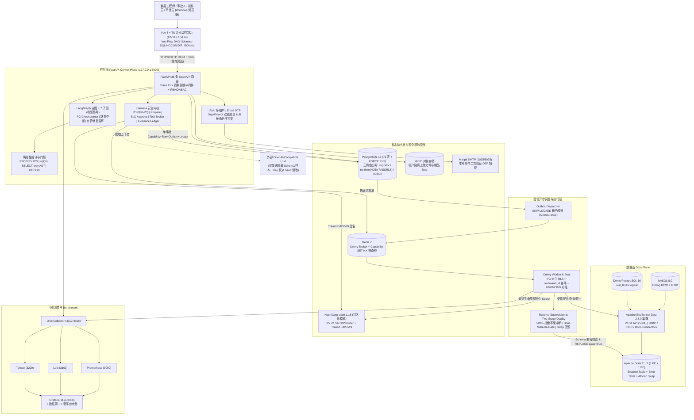
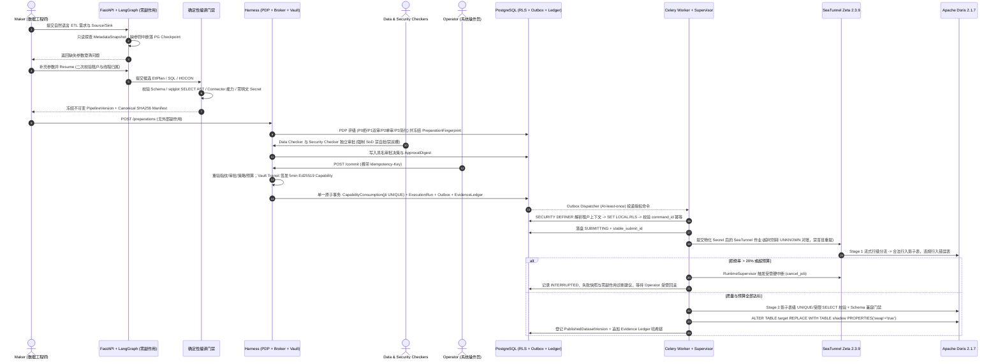
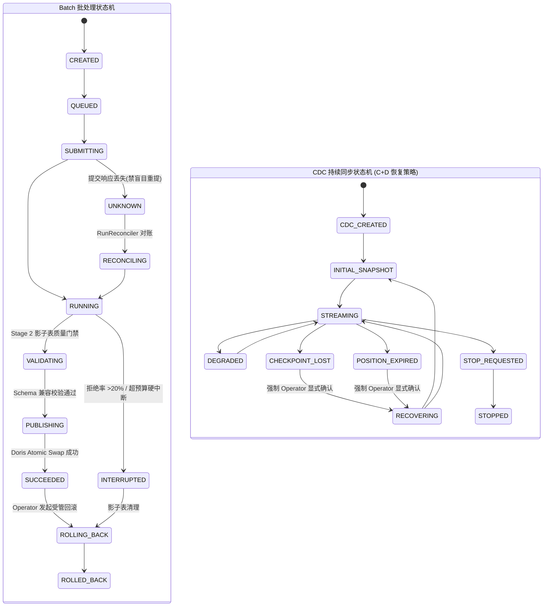

# 生产级 ETL-Agent 异构数据集成平台

> **面向企业级安全边界与受管执行架构的参考实现**  
> **技术栈**：Vue 3 + TypeScript + Vue Flow + Monaco + ECharts ｜ FastAPI + SQLAlchemy 2.0 + PostgreSQL 16 (RLS) + Redis 7 + Celery ｜ LangGraph (主+7子图) + OpenAI-Compatible LLM ｜ HashiCorp Vault 1.18 (持久化 KV v2 + Transit Ed25519) + MinIO + Mailpit ｜ Apache SeaTunnel Zeta 2.3.9 + Apache Doris 2.1.7 + MySQL 8.0 + PostgreSQL 16 (CDC) ｜ OpenTelemetry + Prometheus + Loki + Tempo + Grafana 11.4

---

## 1. 项目概述与核心工程价值

本项目实现了一套**控制面与数据面严格分离、不可信 Agent 零副作用隔离**的受管数据集成平台：

1. **自然语言 → 可验证、不可变 ETL 制品**：数据工程师（Maker）通过自然语言描述同步目标，由 LangGraph 主/子图完成只读元数据探查、缺参中断澄清（PostgreSQL Checkpoint）与结构化候选生成，经确定性编译与门禁（JSON Schema、`sqlglot` `SELECT`-only AST 白名单、Connector 能力矩阵、HOCON 校验）通过后，冻结为不可变 `PipelineVersion` 与 RFC 8785 Canonical SHA256 `ArtifactManifest`。
2. **Agent 零副作用与 Harness 安全内核**：Agent 严禁直接写业务库、提交 SeaTunnel 作业、签发 Capability 或执行 Commit/Rollback。所有外部副作用必须经 **Tool Broker** 执行完整闭环：`Prepare（PDP 风险定级与指纹冻结） → Approve（Data Checker + Security Checker 双独立审批，强制 SoD） → Commit（Operator 触发，单一 PG 事务内完成 5 分钟 Ed25519 Capability 签发消费 + ExecutionRun + Outbox + Evidence Ledger）`。
3. **真实数据面搬运、两阶段质量治理与原子发布**：Celery Worker 不信任消息体，经 PostgreSQL 派生租户 RLS 上下文并幂等调用 Apache SeaTunnel Zeta 2.3.9 集群；有效数据写入目标影子表，违规数据分流至错误表；`RuntimeSupervisionEngine` 实时评估预算与拒绝率（`reject_rate = error_rows / validated_rows`，严格 `> 20%` 触发硬中断）；质量门禁与 Schema 兼容校验通过后，经 Apache Doris `ALTER TABLE ... REPLACE WITH TABLE ... PROPERTIES('swap'='true')` 原子发布并登记 `PublishedDatasetVersion` 支撑受管回滚。
4. **诚实的工程边界声明**：本项目定位为高完成度生产架构参考实现，不宣称跨异构系统的全局分布式 ACID / 通用 Exactly-once；Evidence Ledger 采用 SHA256 哈希链 + 周期 Ed25519 Checkpoint（非外部 WORM 防删除存储）；Email OTP 诚实标注为“邮件二次验证”（非 NIST SP 800-63B 抗钓鱼强 MFA）；连接器能力由版本化 Connector Registry 如实驱动，绝不虚标未验证连接器。

---

## 2. 系统总体架构图



---

## 3. 核心业务流程时序图（需求编译 → Harness 审批 → 受管执行 → 原子发布）



---

## 4. ExecutionRun 双模式生命周期状态机（Batch vs CDC）

Batch 与 CDC 共用统一的 `execution_runs` 主实体，但严格分离生命周期守卫（定义于 [execution_state_machine.yaml](file:///d:/etl-agent/contracts/harness/execution_state_machine.yaml)），**CDC 永续作业绝不复用批处理的 `SUCCEEDED` 终态**：



---

## 5. 代码仓库目录结构

```text
etl-agent/
├── compose.yaml                      # 单一 Docker Compose（15 核心/数据面/观测服务 + 扩展 Profile，仅绑定 127.0.0.1）
├── requirements.txt                  # Python 后端全量依赖清单 (pip install -r requirements.txt)
├── .env.example                      # 本地开发占位符模板（严禁提交真实 .env 与私钥）
├── contracts/                        # Layer 0 冻结公共契约（OpenAPI 3.1 / JSON Schemas / JCS 测试向量 / 状态机）
├── backend/
│   ├── migrations/versions/          # Alembic 迁移（0001 71表 / 0002 FORCE RLS / 0003 身份归属 / 0004 自助注册）
│   ├── app/
│   │   ├── api/                      # OpenAPI 路由与 wiring.py 全模块实机装配（含员工自助注册与管理员账号治理）
│   │   ├── auth/ organizations/ projects/ memberships/   # IAM、Email OTP、员工注册、双层成员与 SoD
│   │   ├── connections/ metadata/ secrets/               # 连接版本化、只读探查/Drift、Vault KV v2
│   │   ├── agent/ artifacts/ pipeline/ sql_analysis/ compiler/ hocon/ # LangGraph + 编译门禁
│   │   ├── policy/ preparations/ approvals/ capabilities/ broker/ evidence/ security/ # Harness 安全内核
│   │   ├── connectors/ data_plane/ execution/ quality/ supervision/ publishing/ rollback/ # 数据面与发布
│   │   ├── scheduling/ observability/ shared/            # 受管调度、OTel/Metrics、71 表 ORM & RLS
│   └── workers/                      # Celery Worker/Beat 任务注册与 Outbox Dispatcher
├── frontend/                         # Vue 3 + TS + Tailwind v4 + shadcn-vue + Vue Flow + Monaco + ECharts 控制台
├── seatunnel/templates/              # SeaTunnel Zeta 2.3.9 Batch / 质量分流 / MySQL&PG CDC HOCON 模板
├── observability/                    # OTel Collector、Prometheus、Loki、Tempo、Grafana 3 数据源 + 5 大盘
├── benchmarks/                       # 10K/100K/1M 固定种子数据生成器 + L0/L1/L2 评测与 P0/P1 硬门槛引擎
├── infra/                            # PostgreSQL 三角色脚本、MySQL/PG CDC 初始化、Vault 持久化配置、Doris/Zeta 配置
└── scripts/dev/                      # Windows PowerShell 启停/Vault 自动初始化解封脚本 + seed_demo.py
```

---

## 6. 本机一键启动与快速上手指南

### 6.1 安装依赖与启动服务
```powershell
# 0. 安装 Python 依赖与前端依赖
pip install -r requirements.txt
pnpm --dir frontend install

# 1. 复制本地环境变量（若尚未创建 .env）
if (-not (Test-Path .env)) { Copy-Item .env.example .env }

# 2. 启动全部 15 个核心/数据面/可观测性容器
docker compose up -d postgres redis vault minio mailpit demo-mysql demo-postgres doris-fe doris-be seatunnel-zeta otel-collector prometheus loki tempo grafana

# 3. 幂等初始化 / 解封持久化 Vault（自动挂载 kv-v2 与 Transit Ed25519 密钥）
powershell -NoProfile -ExecutionPolicy Bypass -File scripts\dev\init-vault.ps1

# 4. 执行 PostgreSQL 71 表 + FORCE RLS 数据库迁移
Push-Location backend; python -m alembic upgrade head; Pop-Location

# 5. 初始化 6 类演示角色账号与演示数据源连接（凭据存入 Vault KV v2）
python scripts\dev\seed_demo.py

# 6. 启动后端控制面与前端控制台（分别在两个终端）
python -m uvicorn app.main:app --app-dir backend --host 127.0.0.1 --port 8000
pnpm --dir frontend dev
```

### 6.2 访问入口、员工自助注册与预置演示账号

- **Vue 3 Web 控制台**：`http://127.0.0.1:5174`（支持登录页 **新员工自助注册**，默认分配最小权限 `MAKER`；管理员可在左侧「成员与账号管理」增删改角色与启停账号）
- **FastAPI OpenAPI 文档**：`http://127.0.0.1:8000/docs`
- **Mailpit 邮件二次验证（查看 6 位 OTP 验证码）**：`http://127.0.0.1:8025`
- **Grafana 可观测性大盘（5 套内置看板）**：`http://127.0.0.1:3000`
- **MinIO 对象存储控制台**：`http://127.0.0.1:9001`

**所有演示账号统一初始密码：`DemoPass!2026`**（登录第一步输入邮箱和密码，第二步到 Mailpit `http://127.0.0.1:8025` 复制 6 位数字验证码填入即可）：

| 角色 | 登录邮箱 | 典型操作演示 |
|---|---|---|
| `MAKER` | `maker@etl-agent.local` | 数据源连接与只读探查、Pipeline Studio 自然语言生成与冻结版本、发起 Prepare（严禁自批） |
| `DATA_CHECKER` | `data_checker@etl-agent.local` | 审批中心审阅 Schema/映射/质量规则并审批 `DATA_CHECKER` 槽位 |
| `SECURITY_CHECKER` | `security_checker@etl-agent.local` | 审批中心审阅分级/Secret/预算/回滚计划并审批 `SECURITY_CHECKER` 槽位 |
| `OPERATOR` | `operator@etl-agent.local` | 双审通过后执行 Commit、运行中心监控、受管中断与回滚 |
| `AUDITOR` | `auditor@etl-agent.local` | 只读查看 Evidence Ledger 哈希链校验与 Benchmark 趋势 |
| `ADMIN` | `admin@etl-agent.local` | 「成员与账号管理」新增企业员工、调整 RBAC 角色与启停账号 |

---

## 7. 前端构建与类型检查

```powershell
# Vue 3 前端类型检查与生产构建
pnpm --dir frontend typecheck
pnpm --dir frontend build
```
